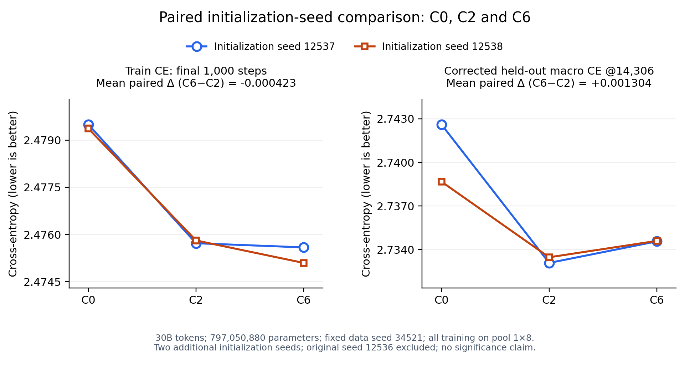

# MoSE 项目概况、当前结果与创新点

当前任务快照（2026-10-10 22:02 HKT）：C9、L1、R0–R3六条均已完成30B/14306步，Succeeded/active=0，最终checkpoint保存成功已核实。完整末期Train CE尚待汇总；C9的HF转换及OLMES尚待处理。完整配置与终态证据见[当前实验清单](CURRENT_EXPERIMENTS.md)。

文档更新：2026-10-09。训练与终点证据截至2026-10-07 16:28 HKT，完整Train CE统计截至2026-10-07 16:36 HKT；本次依据已核实结果补充overview。C0/C2/C6两组新增初始化种子的Train CE与修正后最终验证已于10月7日12:36 HKT核实。A1/A2及十组FFN预算重分配均完成完整CE统计，未超过C6。

本期清单见[9月17日之后的实验汇总](EXPERIMENT_SUMMARY_20260907_20261007.md)：45条可核实训练run均完成30B，45条均有完整CE统计；每条完整W&B名称和链接直接列在报告中，逐run指标及来源另存CSV。

最新补充：10月8日完成的W1/W1-QK/W1-M/W2/G1已汇总完整末1000步Train CE。缩宽并回补rank的W1/W2未超过C2/C6；G1无约束可学习Q/K变换为2.473732，较C6低0.001031，但多32个标量且只有一次新运行。严格797,050,880参数预算中仍以C6最低；G1作为近似同预算的新候选。用户要求仅分析Train CE，额外checkpoint评测已停止，未用于本次选型。[完整新结果和W&B名称](scripts/train/FFN_Width_Ablations/COMPLETED_RESULTS_20261009.md)。

## 可直接用于汇报的一段话

MoSE 项目研究如何从头训练一个参数更少、质量尽量接近 Dense Transformer 的语言模型。我们以 OLMo3-1B 为基础，把 Attention 和 FFN 的大线性投影拆成低维编码与输出读出，围绕三个问题开展实验：低秩表示在哪些位置需要非线性、哪些投影适合共享输入子空间，以及如何在相同参数预算下重新分配秩。主要发现是，中间变换需要按投影功能选择，不能统一加入 SiLU：Down 移除中间 SiLU 后更好；Up/Gate 保持中间 Linear、保留原生 SwiGLU 门控更好；共享、激活和秩分配的收益也不能简单相加。目前按完整30B训练末1000步平均 Train CE 选型，严格797,050,880参数预算中最好的已测试配置是 C6：Q/K/V rank512、O rank496，Q/K SiLU、V/O Linear，Up/Gate共享rank568且中间Linear，Down rank520、无可学习gain的RMSNorm。它有约7.97亿参数，比约14.85亿参数的 Dense 少46.3%；原始运行的末期 Train CE 为2.4748，优于同预算、不共享的 C0 的2.4790。新增两组初始化种子都重复了相同取舍：C6的Train CE最低，C2的最终验证CE最低；C2和C6均优于C0。两种子平均Train CE为C0 2.479432、C2 2.475767、C6 2.475344，修正后最终验证CE为2.740639、2.733280、2.734584。最新补齐的十组FFN预算重分配和两组Attention预算重分配都未超过C6；固定Attention rank512时，F组最好是UG共享480／Down672的F3QK，末期CE为2.477421，与不共享512／512参考近乎持平。当前的创新主线是按位置设计低秩中间变换，并联合设计输入子空间共享与参数预算分配，以受控消融和重复实验支持这一组合。额外Q SiLU仅带来较小的训练收益，未改善验证；Dense在两个指标上仍优于低秩模型，尚未实现以这一低秩预算追平Dense。

## 1. 模型和参数预算

普通线性投影是 \(Y=XW\)，低秩模块改为

\[
a=XA,\qquad z=\phi(a),\qquad Y=zB,
\quad A\in\mathbb R^{d_{in}\times r},\ B\in\mathbb R^{r\times d_{out}}.
\]

\(a\) 是激活前的低维表示，\(z\) 是经过 Identity、SiLU 或 RMSNorm 后的表示。Identity 时是线性低秩分解；加入非线性后，整个模块不能再直接等同于一个秩为 \(r\) 的线性矩阵。本项目是从头预训练，SVD 也用于初始化随机权重，并非压缩已训练模型。

“共享”指多个投影共用输入因子 \(A\)，各自保留输出因子 \(B\)，例如

\[
Q=\phi(XA_{qk})B_q,\qquad K=\phi(XA_{qk})B_k.
\]

这不意味着 Q、K 输出相同。当前主要比较两个参数预算：

| 预算 | 参数量 | 用途 |
| --- | ---: | --- |
| 所有投影独立 rank512 的低秩参考 | 797,050,880 | 主要结构消融及组合选型 |
| 原生 Dense | 1,484,916,736 | 判断低秩模型与 Dense 的质量差距；另做 Dense 预算消融 |

共享会节省参数，因此严格同预算组合会把节省的参数重新分配到秩；共享后的模型不再要求每个投影都为512。C0–C8 每层投影参数均为24,117,248。参数匹配不代表实际吞吐、显存或训练时间匹配。

训练骨架为16层、残差维度2048、FFN宽度8192。主要设置为序列长度8192、全局batch256、30B tokens（14,306 steps）、Muon LR 0.005、WSD warmup2000、末尾20% decay、FP8。当前新实验每卡microbatch为32,768 tokens，通过梯度累积保持全局batch。

## 2. 当前最好的是哪个

### 低秩预算：Train CE 目前选择 C6

以下结果来自[二十配置同口径完整比较](scripts/train/UG_Partial_Sharing/P3_P4_QK_RESULTS.md)、[全部FFN重分配比较](scripts/train/FFN_Rank_Reallocation/analysis/FFN_ALL_WITH_REFERENCES_FULL_TRAIN_CE.json)及[A1/A2完整历史比较](scripts/train/Attention_Rank_Reallocation/analysis/A1_A2_WITH_REFERENCES_FULL_TRAIN_CE.json)，表中配置均为797,050,880参数。共同排除异常step12516；末期窗口为steps13307–14306，共1000个有效点。

| 配置 | 主要结构 | 全程平均 Train CE | 末1000步平均 Train CE |
| --- | --- | ---: | ---: |
| C0 | K SiLU；全部独立rank512 | 2.793314 | 2.478978 |
| C2 | K SiLU；UG共享并重新分配秩 | 2.791299 | 2.475668 |
| **C6** | **Q/K SiLU；UG共享并重新分配秩** | **2.789407** | **2.474763** |
| P0qk | Q/K SiLU；UG独立512 | 2.791090 | 2.477410 |
| F3qk | Q/K SiLU；UG共享480、Down672 | 2.791282 | 2.477421 |
| F5qk | Q/K SiLU；UG共享560、Down528 | 2.793772 | 2.479613 |
| P4qk | Q/K SiLU；UG共享160＋各私有368 | 2.796336 | 2.481281 |
| P3qk | Q/K SiLU；UG共享320＋各私有224 | 2.795581 | 2.481997 |
| F4qk | Q/K SiLU；UG共享400、Down816 | 2.799332 | 2.485783 |
| F1qk | Q/K SiLU；UG独立384、Down768 | 2.797279 | 2.483381 |
| F2qk | Q/K SiLU；UG独立256、Down1024 | 2.807328 | 2.494263 |
| F4 | Attention512；UG共享400、Down816 | 2.799987 | 2.486620 |
| F5 | Attention512；UG共享560、Down528 | 2.797488 | 2.484029 |
| A1 | Attention832；UG独立336、Down352 | 2.806921 | 2.498468 |
| A2 | Attention832；UG共享320、Down448 | 2.808386 | 2.498580 |

C6 比 C0 改善约0.004215，比 C2 仅改善约0.000905；这里是原始种子12536的架构筛选结果。新增两组初始化种子也均支持C6的Train CE低于C0及C2，最终验证则均以C2低于C6，见下表。有效标签mask修正后，原始低秩配置的最终step14306验证macro CE同样以C2最低（2.732681，C6为2.734855）。当前按用户指定的Train CE选择C6，同时保留C2为验证集优选及关键对照。P0qk和F3qk几乎持平；十组FFN重分配及A1/A2均已完成完整统计，没有改变当前选型。原始七配置的Train/Validation取舍见[同预算结果图](scripts/analysis/Corrected_LM_Evaluation/figures/train_vs_corrected_validation_seven.svg)。

**C0/C2/C6的两组新增配对重复：** 初始化seed12537/12538，固定数据seed34521，均为pool 1×8、相同全局batch和797,050,880参数，完整训练14,306步。六次历史均无缺失或异常点，末期窗口均含1000步。下表取两个新增种子的平均，不混入原始seed12536。

| 配置 | 两种子平均末1000步 Train CE | 两种子平均修正后最终验证macro CE |
| --- | ---: | ---: |
| C0 | 2.479432 | 2.740639 |
| C2 | 2.475767 | **2.733280** |
| C6 | **2.475344** | 2.734584 |

C2相对C0平均改善Train CE 0.003664、验证CE 0.007360；C6相对C0改善0.004087、0.006055。C6与C2的模型配置只在Q的中间SiLU上不同：它在两种子下分别改善Train CE 0.000132/0.000714，平均0.000423；最终验证却分别恶化0.001481/0.001128，平均0.001304。这支持训练与验证取舍的方向重复，不能把两个固定数据顺序的初始化重复宣称为统计显著，也不能把C2相对C0的共享与秩重分配组合收益全部归因于共享。详见[三配置两种子完整报告](scripts/train/Rank512_Seed_Replication/C0_C2_C6_RESULTS.md)。

两种颜色对应两组初始化种子；左图为末1000步平均Train CE，右图为修正后最终验证macro CE。[SVG](scripts/analysis/Corrected_LM_Evaluation/figures/paired_seed_c0_c2_c6.svg) / [PDF](scripts/analysis/Corrected_LM_Evaluation/figures/paired_seed_c0_c2_c6.pdf) / [作图数据](scripts/analysis/Corrected_LM_Evaluation/figures/paired_seed_c0_c2_c6.csv)。原有[C0/C6四次报告](scripts/train/Rank512_Seed_Replication/C0_C6_RESULTS.md)及其图保留。

**C6 的完整配置：** Q512/SiLU、K512/SiLU、V512/Identity、O496/Identity；Attention不共享。UG共享rank568，因子之间Identity；Down rank520、无可学习gain的RMSNorm。

\[
Q=\mathrm{SiLU}(X_AA_q)B_q,\quad
K=\mathrm{SiLU}(X_AA_k)B_k,\quad
V=(X_AA_v)B_v,
\]
\[
Z=\mathrm{Attention}(Q,K,V),\qquad Y_A=(ZA_o)B_o,
\]
\[
S=X_FA_{ug},\quad G=SB_g,\quad U=SB_u,\quad
H=\mathrm{SiLU}(G)\odot U,\qquad
Y_F=\mathrm{RMSNorm}(HA_d)B_d.
\]

\(X_A\)、\(X_F\) 分别是对应分支输入，O接收Attention输出。公式省略外围残差、原有归一化、QK norm及RoPE；这些沿用OLMo配置。**UG的“Linear”只表示两低秩因子之间不加额外激活，原生SwiGLU的SiLU门控仍保留。**

配置代码：[C6](cfps/BS256_Seq8K_30B_WSD_FP8/Rank512Matched_Combinations/c6_qk_silu_down_rms_gateup.py)。W&B：[olmo3-1b-r512matched-c6-qk-silu-down-rms-gateup-fp8-30b](https://wandb.ai/archspace/MoSE/runs/olmo3-1b-r512matched-c6-qk-silu-down-rms-gateup-fp8-30b)。

### 同参数量下，UG与Down的维度怎样选

固定的是**全模型797,050,880参数**，不是所有投影必须为rank512。需要区分下面两种搜索约束；表中的rank均为因子之间的latent维度，UG共享只共享输入因子，Up/Gate输出读出独立。

| 搜索约束 | 最好配置 | UG rank／共享 | Down rank | Attention配置 | 末1000步Train CE |
| --- | --- | --- | ---: | --- | ---: |
| 允许全模型各投影重新分配秩 | **C6** | **568／共享** | **520** | Q/K/V512、O496；Q/K SiLU | **2.474763** |
| 固定Attention512，只在FFN内部重分配；F1–F5及QK变体 | F3QK | 480／共享 | 672 | Q/K/V/O512；Q/K SiLU | 2.477421 |
| 固定Attention512的独立FFN参考 | P0QK | 512／不共享 | 512 | Q/K/V/O512；Q/K SiLU | 2.477410 |

F3QK是十组F配置里最好的一组，但与P0QK仅差约0.000011，仍比C6高0.002658。C6将O从512减为496，给FFN多出每层65,536参数；因此568／520与480／672对应不同的模块预算约束，不能只把区别归因于UG共享或某一个rank。目前优先保留C6的568／520组合，验证指标另保留同秩分配的C2；这些是已测试组合的结果，尚不能称为全局最优。

### FFN预算重分配：五个维度组合与两种Q/K变换

十条均完成30B／14306步。Attention各投影独立rank512，V/O中间Linear；UG中间Linear并保留原生SwiGLU，Down无gain RMSNorm。每层FFN投影参数均15,728,640，全模型均797,050,880参数。Identity版的Q/K中间Linear，QK版仅在独立Q/K中间加SiLU，不共享Q/K输入因子。

以下均为末1000步平均Train CE，共同排除异常step12516，末窗1000个有效点；全程均值、历史来源及SHA256见[十组统一统计](scripts/train/FFN_Rank_Reallocation/analysis/FFN_ALL_WITH_REFERENCES_FULL_TRAIN_CE.json)。每个配置的完整W&B名称直接列在表中。

| 配置 | UG rank／共享 | Down rank | Q/K Linear：CE | Q/K SiLU：CE | W&B完整名称（Linear） | W&B完整名称（SiLU） |
| --- | --- | ---: | ---: | ---: | --- | --- |
| F1／F1QK | 384／不共享 | 768 | 2.482142 | 2.483381 | [olmo3-1b-ffn-budget-f1-ug384-down768-unshared-linear-rms-fp8-30b](https://wandb.ai/archspace/MoSE/runs/olmo3-1b-ffn-budget-f1-ug384-down768-unshared-linear-rms-fp8-30b) | [olmo3-1b-ffn-budget-f1qk-ug384-down768-unshared-qk-silu-ug-linear-down-rms-fp8-30b](https://wandb.ai/archspace/MoSE/runs/olmo3-1b-ffn-budget-f1qk-ug384-down768-unshared-qk-silu-ug-linear-down-rms-fp8-30b) |
| F2／F2QK | 256／不共享 | 1024 | 2.498586 | 2.494263 | [olmo3-1b-ffn-budget-f2-ug256-down1024-unshared-linear-rms-fp8-30b](https://wandb.ai/archspace/MoSE/runs/olmo3-1b-ffn-budget-f2-ug256-down1024-unshared-linear-rms-fp8-30b) | [olmo3-1b-ffn-budget-f2qk-ug256-down1024-unshared-qk-silu-ug-linear-down-rms-fp8-30b](https://wandb.ai/archspace/MoSE/runs/olmo3-1b-ffn-budget-f2qk-ug256-down1024-unshared-qk-silu-ug-linear-down-rms-fp8-30b) |
| F3／F3QK | 480／共享 | 672 | 2.481782 | 2.477421 | [olmo3-1b-ffn-budget-f3-ug480-down672-shared-linear-rms-fp8-30b](https://wandb.ai/archspace/MoSE/runs/olmo3-1b-ffn-budget-f3-ug480-down672-shared-linear-rms-fp8-30b) | [olmo3-1b-ffn-budget-f3qk-ug480-down672-shared-qk-silu-ug-linear-down-rms-fp8-30b](https://wandb.ai/archspace/MoSE/runs/olmo3-1b-ffn-budget-f3qk-ug480-down672-shared-qk-silu-ug-linear-down-rms-fp8-30b) |
| F4／F4QK | 400／共享 | 816 | 2.486620 | 2.485783 | [olmo3-1b-ffn-budget-f4-ug400-down816-shared-linear-rms-fp8-30b](https://wandb.ai/archspace/MoSE/runs/olmo3-1b-ffn-budget-f4-ug400-down816-shared-linear-rms-fp8-30b) | [olmo3-1b-ffn-budget-f4qk-ug400-down816-shared-qk-silu-ug-linear-down-rms-fp8-30b](https://wandb.ai/archspace/MoSE/runs/olmo3-1b-ffn-budget-f4qk-ug400-down816-shared-qk-silu-ug-linear-down-rms-fp8-30b) |
| F5／F5QK | 560／共享 | 528 | 2.484029 | 2.479613 | [olmo3-1b-ffn-budget-f5-ug560-down528-shared-linear-rms-fp8-30b](https://wandb.ai/archspace/MoSE/runs/olmo3-1b-ffn-budget-f5-ug560-down528-shared-linear-rms-fp8-30b) | [olmo3-1b-ffn-budget-f5qk-ug560-down528-shared-qk-silu-ug-linear-down-rms-fp8-30b](https://wandb.ai/archspace/MoSE/runs/olmo3-1b-ffn-budget-f5qk-ug560-down528-shared-qk-silu-ug-linear-down-rms-fp8-30b) |

大幅减少UG、增加Down的F2最差；共享背景下，中间预算点F3QK优于F4QK和F5QK。最后补齐的F4／F5分别为2.486620／2.484029，均未改变排序。这批实验没有找到额外质量收益，但给出了预算分配边界：增加Down的秩不能简单补偿UG容量的减少。Q/K SiLU在F1末期使CE高约0.001238，在另外四个背景中改善，说明其收益依赖秩配置。硬件及恢复差异保留在各组台账；这是一种初始化seed12536、数据seed34521的筛选，没有对F组做新增种子重复。[配置与预算](scripts/train/FFN_Rank_Reallocation/README.md)／[F4/F5完整历史核实](scripts/train/FFN_Rank_Reallocation/analysis/F4_F5_WITH_REFERENCES_FULL_TRAIN_CE.json)。

### Attention预算重分配：提高到832没有带来收益

A1/A2将部分FFN预算转给Attention，Q/K/V/O均独立rank832；Q/K SiLU、V/O Linear，UG中间Linear、Down无gain RMSNorm。两条均严格797,050,880参数、完整30B，统计窗口与上表一致。

| 配置 | UG rank／共享 | Down rank | 全程平均Train CE | 末1000步Train CE | 末期相对C6 | W&B完整名称 |
| --- | --- | ---: | ---: | ---: | ---: | --- |
| A1 | 336／不共享 | 352 | 2.806921 | 2.498468 | +0.023705 | [olmo3-1b-attn-budget-a1-r832-ug336-down352-unshared-qk-silu-down-rms-fp8-30b](https://wandb.ai/archspace/MoSE/runs/olmo3-1b-attn-budget-a1-r832-ug336-down352-unshared-qk-silu-down-rms-fp8-30b) |
| A2 | 320／共享 | 448 | 2.808386 | 2.498580 | +0.023817 | [olmo3-1b-attn-budget-a2-r832-ug320-down448-shared-qk-silu-down-rms-fp8-30b](https://wandb.ai/archspace/MoSE/runs/olmo3-1b-attn-budget-a2-r832-ug320-down448-shared-qk-silu-down-rms-fp8-30b) |

A1/A2末期均比C6高约0.024，全程平均也更差；两者末期只相差约0.000112。当前不支持通过大幅压缩FFN、提高Attention到832获得更优模型。由于同时改变两个模块的容量，不能单独证明Attention加秩没有价值；A2对A1还同时改变UG共享与FFN秩。新增统一最终验证未覆盖A1/A2，不把Train CE当作其验证结论。[完整历史与校验](scripts/train/Attention_Rank_Reallocation/analysis/A1_A2_WITH_REFERENCES_FULL_TRAIN_CE.json)／[配置](scripts/train/Attention_Rank_Reallocation/README.md)。

### Dense预算：K-only SiLU末期略好，尚无稳定整体提升

| 配置 | 参数量 | 末1000步平均 Train CE |
| --- | ---: | ---: |
| Dense | 1,484,916,736 | 2.357587 |
| 只将Q改为rank1024 + SiLU | 1,484,916,736 | 2.357467 |
| 只将K改为rank1024 + SiLU | 1,484,916,736 | **2.356372** |
| 只将Up改为rank1632 + SiLU | 1,483,868,160 | 2.363876 |
| 只将Gate改为rank1632 + SiLU | 1,483,868,160 | 2.361813 |
| S1：UG共享、Linear | 1,481,246,720 | 2.368455 |
| S2：KV共享、Linear | 1,484,392,448 | 2.358965 |
| S3：UG与KV共享、Linear | 1,480,722,432 | 2.371111 |

K-only末期比Dense低约0.001215，但全程平均CE仍以Dense更好。Up-only和Gate-only增加中间SiLU后都变差；二者按向下取整的rank近似匹配，参数比Dense少0.0706%。S1–S3也按向下取整的秩近似匹配参数，均未超过Dense。这组原有Dense Down保留，不能与“所有投影都低秩、Down RMSNorm”的C系列混为一组。Dense参考与新实验的microbatch及部分初始化也有差异。详见[Dense单点SiLU](scripts/train/Dense_Single_SiLU/RESULTS.md)和[Dense预算共享](scripts/train/Dense_Sharing/RESULTS.md)。

此前还完成过两个接近Dense预算、全部投影因子化的对照：不共享版本F0的末1000步Train CE为2.392441；KV与UG同时共享的F1为2.397395，二者均1,484,392,448参数、UG中间SiLU、Down RMSNorm。共享版本没有改善质量。**这两个早期F0/F1属于Dense预算实验，与本轮797M预算的FFN重分配F1/F2等名称相似，但配置不同。** 它们说明低秩因子化或共享在高预算下也不自动带来质量提升，不能把C6相对C0的改善推广到所有共享模型。详见[早期Dense预算全投影因子化对照](scripts/train/DenseMatched_MoSE/README.md)。

## 3. 已完成消融的主要结论

| 方向 | 目前效果及结论 |
| --- | --- |
| Down：Identity / SiLU / RMSNorm / RMSNorm∘SiLU | Identity≈RMSNorm，优于SiLU≈RMSNorm∘SiLU。主要收益可以由移除中间SiLU解释；当前组合统一使用Down RMSNorm。 |
| SiLU位置 | 固定低秩预算中Q/K SiLU的C6末期最好，但与K-only的C2差距很小；两组新增种子中C6比C2的Train CE平均仅低0.000423，验证CE反而高0.001304。C8全部Attention Linear、UG共享的结果也接近C2。新F1背景中Q/K SiLU反而使末期CE恶化约0.001238，F2背景则改善约0.004323，说明收益依赖秩分配及比较窗口。 |
| UG是否加中间SiLU | C7相对C6末期CE恶化约0.017519，明显不利；因此保留UG中间Linear及原生SwiGLU。 |
| 输入因子共享 | 早期比较涉及KV、UG、QK、QKV，结果依赖背景。最新C系列支持UG共享与秩重分配的组合，未支持继续叠加KV共享：C1差于C0，C3差于C2。 |
| BF16/FP8 × Down激活 | 7.5B短日程中，两种精度下SiLU与RMSNorm的差距接近，收益并非只在FP8出现；不将短日程当作完整30B结论。 |
| SVD初始化 | 尺度匹配SVD的末1000步CE为2.494134，独立初始化为2.495849，仅改善0.001715。是小幅正向线索，背景与C6不同。 |
| Down输出子空间旋转 | 试过静态、动态及Identity起步的残差旋转；此前观察收益不显著，尚不足以作为主结果。部分配置增加参数，不能直接作为严格同预算对照。 |
| UG部分共享 | P2/P3/P4及其Q/K SiLU版本未超过对应独立端点P0/P0QK，也未超过C6。此结论限于P组配置，不能推广成不共享普遍最好；P组固定Attention/Down512，C2/C6则为O496、UG共享568、Down520。P1参数略少，且缺少P1QK全共享端点。 |
| FFN预算重分配 | 十组均未超过C6。F组最好为UG共享480／Down672的F3QK（2.477421），与独立512／512参考近乎持平；F4/F5补齐后仍无更优配置。已测试配置中，过度削减UG、提高Down不利。 |
| Attention预算重分配 | A1/A2完整末期CE为2.498468/2.498580，均比C6高约0.024。提高Attention到832、压缩FFN的两个预算点未带来收益，不能据此单独判断Attention容量的价值。 |

特征热图提供机制线索：SiLU会改变各通道的相对比例；无gain的RMSNorm主要缩放整个token向量。逐token分别除以各自RMS后，RMSNorm前后方向几乎一致是预期现象，不能单凭“变化图接近零”证明质量收益的因果机制。

完整结果：[C0–C7](scripts/train/Rank512Matched_Combinations/C0_C7_RESULTS.md)、[C8](scripts/train/Rank512Matched_Combinations/C8_RESULTS.md)、[Down定义](scripts/train/Down_Identity_Ablations/README.md)、[SVD分析](scripts/analysis/Initialization_Analysis/TRAIN_CE_20260913.md)、[旋转定义](scripts/train/Down_Output_Subspace_Ablations/README.md)。C0–C8原报告共同排除steps12516、14304，末期为999个有效点；其中C6为2.474827，与本文件主表2.474763的微小差别来自比较组的共同异常掩码不同。

## 4. 创新点与论文主线

当前可以形成的研究贡献是：**低秩空间中的非线性应按投影功能设计，而共享结构应与固定预算下的秩分配联合考虑。**

1. **按位置选择中间变换。** 区分Attention Q/K、FFN UG及Down的作用，避免所有位置统一SiLU；通过Down四组、UG激活及单点替换等对照支持设计选择。
2. **共享输入子空间、保留独立读出。** 在UG中共享编码因子，保留Gate和Up各自的输出矩阵；把节省的参数重新分配到秩，并以不共享rank512为严格预算参照。
3. **用组合消融检验相互作用。** 实验说明单项收益不能简单相加，部分共享、额外UG非线性及已测试的激进预算转移均未带来更优组合；C6是目前这一设计过程得到的最好组合。

低秩分解、共享或RMSNorm本身不能直接宣称为新发明。论文应把贡献落在明确的结构设计、受控实验发现和可复现证据上。目前部分共享、输出子空间旋转和更激进的预算分配尚未显示稳定提升，不能提前写成有效创新。参数减少46.3%也不等于同比加速或显存节省。已完成同节点8卡合成训练步微基准：C6吞吐约为Dense的1.235×，但PyTorch峰值allocated为66.31GiB，高于Dense的51.27GiB；这不包含数据加载、验证和checkpoint开销，不能当作完整训练效率。详见[效率微基准](scripts/analysis/Training_Efficiency/RESULTS.md)。

## 5. 当前进度与剩余工作

2026-10-07 16:28 HKT核实：本轮27个训练配置均已完成30B并保存最终checkpoint。A1/A2的精确W&B段同步完成，完整14306步Train CE已通过无采样API历史验证，末1000步CE为2.498468/2.498580，均比C6高约0.024。F4/F5也已确认Succeeded、active=0及最终保存，精确W&B段同步完成；全部14306步CE已无采样核实，末1000步CE为2.486620/2.484029，均未超过C6。这一计数不包含更早已完成的C系列及Dense系列，也不包含独立分析任务。C0/C2/C6六次重复均已完成并确认W&B上传；完整Train CE与最终统一验证分析于12:36 HKT全部核实成功。此前P3qk/P4qk的上传及完整Train CE联合分析均已确认成功，均未超过C6。

- **P系列：** 九组不同共享比例及Q/K SiLU组合均完成；部分共享未超过对应独立端点或C6，保留全共享端点与C系列背景差异的核查问题。
- **F系列：** 十组完整CE均已统计；UG共享480／Down672的F3QK是F组最好，未超过C6。F4/F5及对应QK版本已补齐共享背景的三个预算点与两种激活对照。
- **A1/A2：** 两组均完成训练、W&B同步与完整CE统计；Attention832的两个预算点均差于C6约0.024，暂不替换主配置。
- **重复种子：** C0/C2/C6各补两种初始化种子12537、12538，固定数据seed34521。六次运行、完整Train CE分析和统一最终验证均已完成；两组重复都支持C6的Train CE最低、C2的验证CE最低，C2/C6均优于C0。

旧LM评估的有效标签mask存在shift对齐问题，验证集继续作为辅助证据。独立重评已于03:49完成，P0qk/F3qk最终checkpoint的修正后macro CE分别为2.736912/2.737175；同forward比较显示旧mask低估约0.006865。C0/C2/C6的统一重评也已于04:07核实完成，修正后的最终验证macro CE为2.738866/2.732681/2.734855；C2最好。F4qk/F5qk统一最终验证已于05:33确认完成，修正后的macro CE为2.745877/2.738925，均未超过C2或C6。Dense的同口径最终重评也已于05:57确认完成，修正后macro CE为2.627212，仍优于同低秩预算的最优C2（2.732681）；两个模型参数预算不同，详见[Dense统一对照](scripts/analysis/Corrected_LM_Evaluation/DENSE_COMPARISON.md)。详见[有效标签mask重评](scripts/analysis/Corrected_LM_Evaluation/RESULTS.md)。选型仍依据完整Train CE，不以未完成任务的早期loss判断新最优。

45条本期训练均已完成完整CE统计，F4/F5和A1/A2的训练与Train CE已没有待补项。论文剩余工作主要是统一下游质量评估、包含数据加载与保存开销的实际训练效率和显存测量，并将共享结构、秩重分配与初始化的影响分别说明。现阶段按主要Train CE推荐C6作为低秩主配置，以C0、验证优选C2、独立Q/K SiLU参考P0QK和Dense作为关键对照。

## 新一轮：FFN展开宽度与瓶颈（2026-10-08）

W1、W1-QK、W1-M、W2、G1均已完成30B/14306步，Succeeded/active=0，最终checkpoint保存成功；每条pool1×8H200、PRIORITY=1。末1000步Train CE分别为2.481117、2.481223、2.497229、2.490827、2.473732，参考C2/C6为2.475668/2.474763。宽度组合没有改善质量；G1比C6低0.001031，暂作小幅改善候选。W1-M少约6.8%参数，G1多32个标量，预算边界单列。

| 配置 | FFN宽度 | 共享UG rank | Down rank/RMS | Q/K中间变换 | 参数量 | 用途 |
| --- | ---: | ---: | ---: | --- | ---: | --- |
| W1 | 6144 | 736 | 640 | Linear/SiLU | 797,050,880 | 同预算缩宽并回补两端瓶颈 |
| W1-QK | 6144 | 736 | 640 | SiLU/SiLU | 797,050,880 | 与C2/C6组成Q激活交叉对照 |
| W1-M | 6144 | 568 | 520 | Linear/SiLU | 742,787,072 | 只缩宽的较小模型对照 |
| W2 | 4096 | 976 | 944 | Linear/SiLU | 797,050,880 | 更强的同预算宽度调整 |
| G1 | 8192 | 568 | 520 | 学习alpha，初始0/1 | 797,050,912 | 独立的Q/K非线性强度对照 |

UG中间均Linear并保留原生SwiGLU，Down均无gain RMSNorm，Attention输入因子均独立，Q/K/V rank512、O rank496。W1/W1-QK实际GPU起始全部275张参数、797,050,880个元素的字节SHA256完全相同，训练设置及硬件分配一致。

[详细设计](scripts/train/FFN_Width_Ablations/EXPERIMENT_DESIGN.md) / [启动证据](scripts/train/FFN_Width_Ablations/gpu_startup_validation.json) / [每30分钟进度与W&B名称](scripts/train/FFN_Width_Ablations/RUN_STATUS.md)。末期完整分析见[结果报告](scripts/train/FFN_Width_Ablations/COMPLETED_RESULTS_20261009.md)；本次仅使用Train CE，不纳入额外评测。
