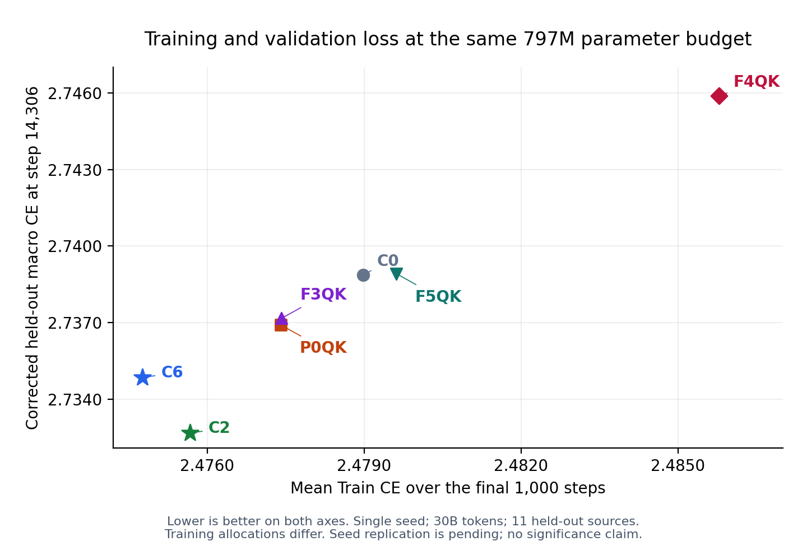

# 最终checkpoint：修正有效标签mask后的LM验证结果

2026-10-07 05:33 HKT。P0qk/F3qk与C0/C2/C6两次pool8、F4qk/F5qk一次arch8低优评估均确认Succeeded、active0/succeeded1；七个最终step14306 checkpoint实际加载，完整评估同11个数据源，每个JSON分别经日志SHA256校验。所有模型均797,050,880参数。

**797M低秩预算内，最终修正后验证指标以C2最好；完整Train CE仍以C6最好。** C6相对C2的Train CE优势没有在这组held-out macro CE中体现，不能将Train CE排名直接写成整体质量排名。

| 配置 | 修正后macro CE@14306 | 同forward旧mask macro CE | mask修正差值 |
| --- | ---: | ---: | ---: |
| c2 | 2.732681404 | 2.725822850 | +0.006858555 |
| c6 | 2.734855153 | 2.727997856 | +0.006857298 |
| p0qk | 2.736911958 | 2.730046890 | +0.006865068 |
| f3qk | 2.737175356 | 2.730310960 | +0.006864396 |
| c0 | 2.738865972 | 2.731997988 | +0.006867983 |
| f5qk | 2.738925078 | 2.732053713 | +0.006871364 |
| f4qk | 2.745877028 | 2.738994815 | +0.006882212 |

C6比C2的修正后macro CE高约0.002174；C2与C6分别比C0低约0.006185和0.004011。P0qk比F3qk低约0.000263，两者仍接近，均未超过C2或C6。F5qk与F4qk也未超过C2或C6。均为单种子，不宣称统计显著或单独将差距解释为过拟合。

旧mask选中5,893,039个位置，实际有效目标为5,874,543个，净差18,496；七组每个数据源的两种计数均一致。get_labels先按输入mask设置ignore再左移label，旧evaluator直接按未移位输入mask选择CE，会纳入部分ignored位置，并可能漏掉某些有效目标。以实际目标标签的有效性作为评分mask可避免该错位。

每个模型在同一forward上同时计算旧mask和labels != ignore_index的新mask；本次mask修正没有改变这七组在同一最终checkpoint评估下的排序。训练代码与上游OLMo-core未修改，没有执行trainer.fit、optimizer step或保存checkpoint。

## Train CE与验证CE的关系

[SVG](figures/train_vs_corrected_validation_seven.svg) / [PDF](figures/train_vs_corrected_validation_seven.pdf) / [作图CSV](figures/matched_quality_seven.csv)；生成脚本：`plot_matched_quality_seven.py`。作图时核对训练历史与评估checkpoint的源任务ID一致。

## 最初五个配置的逐数据源结果

| 数据源 | C0 | C2 | C6 | P0qk | F3qk | 有效目标数 |
| --- | ---: | ---: | ---: | ---: | ---: | ---: |
| c4_en-validation | 3.066968203 | 3.061489344 | 3.061155558 | 3.064283848 | 3.065358400 | 938,695 |
| dolma_books-validation | 2.977987528 | 2.963891268 | 2.968756199 | 2.975178957 | 2.967706442 | 32,764 |
| dolma_common-crawl-validation | 3.200415134 | 3.194432735 | 3.193988085 | 3.196986437 | 3.196466684 | 456,725 |
| dolma_pes2o-validation | 2.218732357 | 2.217365742 | 2.217950106 | 2.220363617 | 2.220133543 | 449,056 |
| dolma_reddit-validation | 3.385458231 | 3.380769491 | 3.378955126 | 3.382915735 | 3.382728577 | 479,565 |
| dolma_stack-validation | 1.367722154 | 1.364616394 | 1.366248369 | 1.368782401 | 1.367020607 | 366,487 |
| dolma_wiki-validation | 2.715079784 | 2.707438231 | 2.707839489 | 2.712877274 | 2.708349228 | 487,185 |
| ice-validation | 3.047140360 | 3.031651497 | 3.048125982 | 3.042185783 | 3.058860064 | 877,279 |
| m2d2_s2orc-validation | 3.197072029 | 3.194349527 | 3.193011284 | 3.196962595 | 3.196580887 | 977,164 |
| pile-validation | 2.309313536 | 2.305878162 | 2.308001518 | 2.308596373 | 2.309648275 | 584,307 |
| wikitext_103-validation | 2.641636372 | 2.637613058 | 2.639374971 | 2.636898518 | 2.636076212 | 225,316 |

## 指标边界与来源

- Macro为同11个数据源CE的等权平均，各源内部按有效目标token平均；不是全部来源token混合的micro平均。
- 本次为最终step14306，旧W&B验证表为step14000。两者差值涉及checkpoint变化，不能全部归因于mask修正。
- 同forward的legacy/corrected比较在每个模型内部成立。七个模型的重评使用三个不同H200节点，均8-rank和同一验证数据；不声称所有模型在同一物理节点评估。
- Dense已于05:57核实完成同口径最终重评，修正后macro CE为2.627212026，优于本表低秩模型；它有1,484,916,736参数，属于不同预算。详见[Dense对照](DENSE_COMPARISON.md)。
- C0/C2/C6实际保存目录从各自原始W&B配置解析，与最终config.json模型及seed核对；runner还检查完整模型配置及seed与最终metadata一致。源任务的旧调度记录未重新取得，不声称这次重新查询了其成功状态。
- 原始训练分配、初始化和恢复差异继续保留；统一8卡评估不消除这些训练归因限制。
- Alignment测试5passed59.99s；真实8卡执行、七次checkpoint加载、11源覆盖及各自JSON/SHA256均已验证。
- 数据：[七配置汇总JSON](SEVEN_CONFIG_FINAL_CHECKPOINT_LM.json)、[保留的五配置汇总](FIVE_CONFIG_FINAL_CHECKPOINT_LM.json)、[F4qk](F4QK_FINAL_CHECKPOINT_LM.json)、[F5qk](F5QK_FINAL_CHECKPOINT_LM.json)、[C0](C0_FINAL_CHECKPOINT_LM.json)、[C2](C2_FINAL_CHECKPOINT_LM.json)、[C6](C6_FINAL_CHECKPOINT_LM.json)、[P0qk](P0QK_FINAL_CHECKPOINT_LM.json)、[F3qk](F3QK_FINAL_CHECKPOINT_LM.json)。
- 任务及校验值：[jobs.json](jobs.json)。完成日志：`completed_pair_observation.log`、`reference_trio_completion.log`、`ffn_qk_pair_observation.log`；实际参考路径：[REFERENCE_CHECKPOINTS.json](REFERENCE_CHECKPOINTS.json)。
