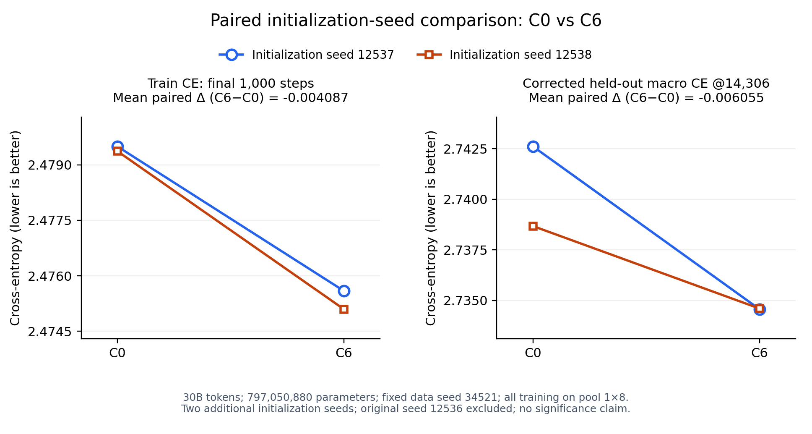

# C0 / C6：两组初始化种子的完整Train CE与最终验证结果

2026-10-07，Train CE于09:59 HKT核实，最终验证于10:29 HKT核实。四个训练任务均已确认Succeeded、active0，完整训练30B（14,306步）并保存最终checkpoint。Train CE分析任务 `mose-report-seed-c0c6-r1-p1-1x8-pool-1007-09-bcc80` 与四checkpoint验证任务 `mose-eval-seed-c0c6-r1-p1-1x8-pool-1007-0958-9a0c4` 均确认Succeeded、active0/succeeded1；完整历史和四份验证输出分别经日志SHA256校验。

**两个新增初始化种子下，C6的末1000步平均Train CE与修正后最终验证CE均优于同参数预算的C0，配对平均分别改善0.004087和0.006055。**

| 初始化seed | 配置 | 全程平均Train CE | 末1000步平均Train CE | 最后一条原始Train CE |
| --- | --- | ---: | ---: | ---: |
| 12537 | C0 | 2.793364 | 2.479496 | 2.509506 |
| 12537 | C6 | 2.790239 | 2.475591 | 2.505631 |
| 12538 | C0 | 2.793096 | 2.479367 | 2.508934 |
| 12538 | C6 | 2.789851 | 2.475098 | 2.505317 |

| 初始化seed | C6−C0：末1000步平均Train CE |
| --- | ---: |
| 12537 | −0.003904628 |
| 12538 | −0.004269808 |
| 两组平均 | **−0.004087218** |

四次运行均797,050,880参数，固定data seed34521，pool 1×8、低优PRIORITY=1，seq8192、global batch256、30B WSD、Muon LR0.005、FP8。四组都有完整的steps1–14306，无缺失、重复、非正或非有限Train CE；共同排除集合为空，末期窗口steps13307–14306均含1000点。

C0为全部投影独立rank512，K中间SiLU、其他Attention和UG中间Identity、Down RMSNorm。C6为独立Q512/K512 SiLU、V512/O496 Identity，UG共享568且中间Identity，Down520 RMSNorm；二者保留原生SwiGLU门控，Down RMSNorm均无可学习gain。具体配置见[项目概况](../../../PROJECT_OVERVIEW.md)。

这是固定数据顺序下的初始化种子重复，暂不宣称统计显著。原始seed12536的归档运行未纳入这两组配对均值。C6同时改变Q激活、共享和秩分配，不能把组合收益单独解释为共享的因果收益。本报告保留四次C0/C6的数据；C2两组补测与验证已于12:36 HKT核实完成，三配置对照见[完整报告](C0_C2_C6_RESULTS.md)。

## 同一最终step14306的修正后验证

| 初始化seed | C0验证macro CE | C6验证macro CE | C6−C0 |
| --- | ---: | ---: | ---: |
| 12537 | 2.742605827 | 2.734566862 | −0.008038965 |
| 12538 | 2.738672679 | 2.734601259 | −0.004071420 |
| 配对平均差 | | | **−0.006055193** |

四个实际最终checkpoint在同一8卡H200节点顺序加载，均按同11个验证源计算等权macro CE。每源内部按实际有效目标token平均；四组每个数据源的计数一致，总有效目标5,874,543，同forward旧mask选择5,893,039。模型配置、初始化seed、源训练任务与checkpoint路径均核对，评估未训练或保存源模型。

该验证结论补充了Train CE的重复证据，支持C6组合相对C0的改善；本报告只比较C0/C6。后续三配置重复显示C6的Train CE较低、C2的验证CE较低，详见上述完整报告。固定数据顺序、固定验证集和两组初始化重复仍不支持统计显著性声明。Train CE JSON中的旧W&B验证来自step14000，不能与本表修正后的最终验证混用。

[SVG](../../analysis/Corrected_LM_Evaluation/figures/paired_seed_c0_c6.svg) / [PDF](../../analysis/Corrected_LM_Evaluation/figures/paired_seed_c0_c6.pdf) / [作图CSV](../../analysis/Corrected_LM_Evaluation/figures/paired_seed_c0_c6.csv)。两种颜色对应两组配对初始化种子，两张图中的下降线段都表示C6的CE低于相应C0。图不包含原始seed12536或C2，未画统计置信区间。生成脚本：[plot_paired_seed_c0_c6.py](../../analysis/Corrected_LM_Evaluation/plot_paired_seed_c0_c6.py)，执行时核对训练和验证payload的SHA256、源任务、预算、初始化、数据seed和训练分配。

数据：[完整Train CE JSON](C0_C6_FULL_TRAIN_CE.json)。训练完成与源任务记录：[jobs.json](jobs.json)。分析任务、校验值及输出证据：[分析任务记录](../UG_Partial_Sharing/reports/jobs.json)、[分析完成日志](../UG_Partial_Sharing/reports/c0_c6_seed_observation.log)。

验证来源：[两组配对汇总](../../analysis/Corrected_LM_Evaluation/SEED_C0_C6_FINAL_CHECKPOINT_LM.json)、[四个精确源checkpoint](../../analysis/Corrected_LM_Evaluation/c0_c6_seed_cases.json)、[验证任务与四份SHA256](../../analysis/Corrected_LM_Evaluation/jobs.json)、[实际验证日志](../../analysis/Corrected_LM_Evaluation/c0_c6_seed_observation.log)。
